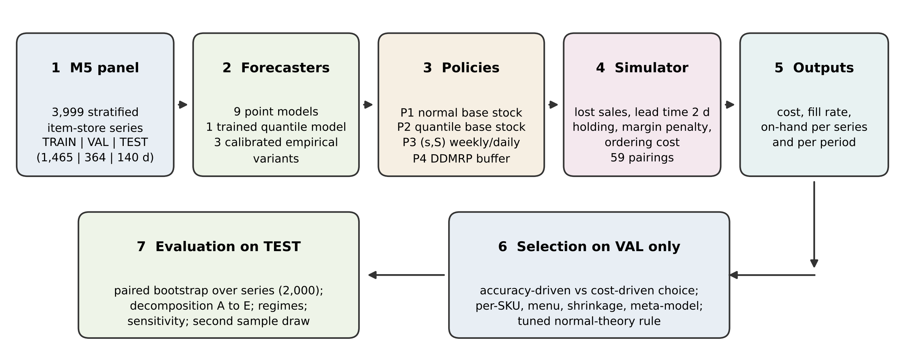
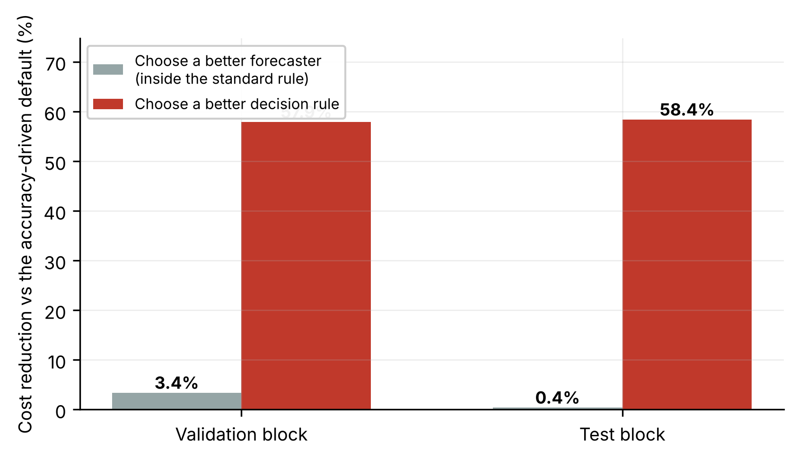
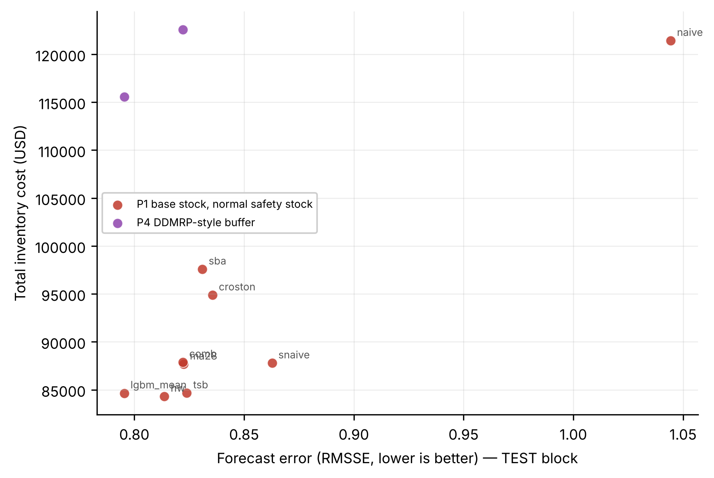
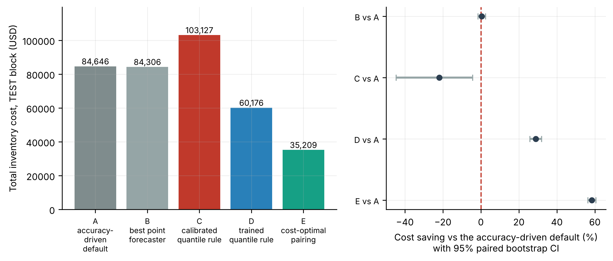
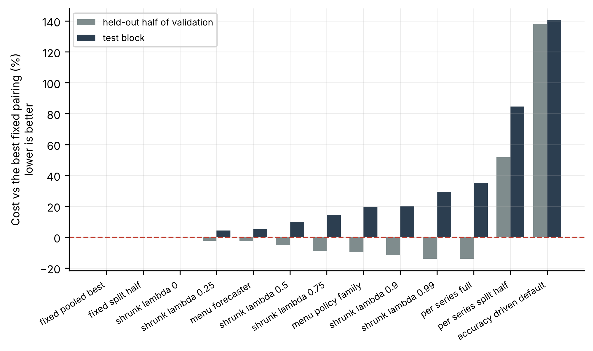
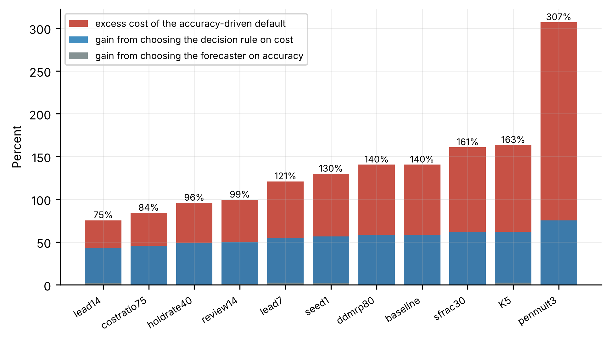
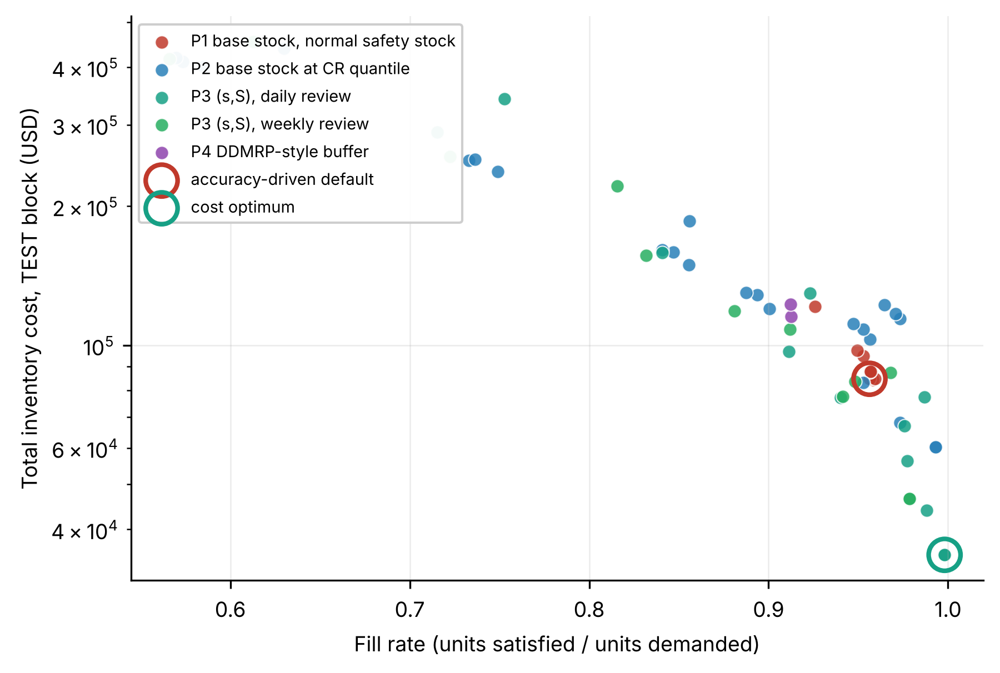

## Abstract

Forecast accuracy is the usual yardstick for demand forecasting, but a forecast creates value only through the inventory decisions it supports. We measure the gap between the two on 3,999 real retail series from the M5 data, using a lost-sales, periodic-review simulation with a margin-based cost model. Nine point forecasters, one trained quantile model and three calibrated empirical-interval variants are paired with four replenishment policies (59 pairings). All selection uses a validation year, and results are reported on a held-out 140-day test block with paired bootstrap intervals.

The forecaster chosen on out-of-sample RMSSE and run through the standard normal-theory base-stock rule costs 140.4% more than the cost-optimal pairing (95% CI [128.8, 153.4]) and delivers a lower fill rate. Swapping the forecaster inside that rule gains 0.4% (CI [-1.5, 2.5]); swapping the rule gains 58.4%. A normal-theory rule tuned on validation data narrows the gap but remains 25.8% above the optimum. Our pooled empirical calibration raises cost by 21.8%, whereas a trained quantile model lowers it by 28.9%. Choosing a pairing per SKU costs 34.9% more than one portfolio-level choice, although an unattainable oracle would save 19.7%. The best pairing is the same in every demand regime we label, and the gap persists in nine alternative decision environments and an independent sample. Accuracy-led evaluation optimises the wrong objective for replenishment, and we describe a cheap decision-cost selection protocol.

**Keywords:** demand forecasting; inventory control; intermittent demand; quantile forecasting; simulation; retail

## 1. Introduction

### 1.1 Motivation

Demand forecasts are usually judged by their error. The M5 competition, a large retail forecasting exercise, ranked submissions by a weighted root mean squared scaled error computed over a 12-level sales hierarchy (Makridakis et al., 2022a). Industrial platforms report MAPE, WAPE or bias, and academic benchmarks report MASE. All of these assume that a smaller error leads to a better decision.

That assumption can fail. In a newsvendor problem with unequal overage and underage costs, the optimal order is a quantile of demand, not its mean, so a model trained under squared error targets the wrong quantity however accurate it is (Gneiting, 2011). A firm can therefore improve accuracy, feed the new forecasts into an unchanged replenishment rule, and see little benefit.

The principle is familiar (Kolassa, 2016; Fildes et al., 2022). What managers lack is a measurement on a large retail panel of how much it matters and where the loss arises: in the forecast, in how uncertainty becomes a safety buffer, or in the structure of the policy. This paper provides one.

### 1.2 Approach and contributions

We build a lost-sales, periodic-review simulator with costs derived from observable retail economics (price, margin, holding rate, ordering cost) and run 59 forecaster–policy pairings on 3,999 M5 series. We decompose the cost of choosing by accuracy into four steps and put a paired bootstrap interval on each. Because a sceptical reader may suspect that the textbook rule is simply untuned, we also give the normal-theory rule every tuning option we could think of (safety factor, dispersion refresh, review structure) and report what is left. We then test selection methods under a strict validation/test split, check out of sample whether demand regimes change the best pairing, and repeat the analysis in nine other decision environments and on a second sample of series.

The contributions are empirical. We quantify the accuracy-to-decision gap and its sources on a public retail panel, report the gap both against an untuned and against a tuned normal-theory baseline, and show that neither a pooled empirical calibration nor per-SKU selection recovers it in our setting. We close with a selection protocol that uses only a validation window and the organisation's own cost model.

### 1.3 The size of M5

M5 is often said to contain 42,840 series. That figure is the number of series across all 12 aggregation levels used by the WRMSSE metric (1 + 3 + 10 + 3 + 7 + 9 + 21 + 30 + 70 + 3,049 + 9,147 + 30,490). Replenishment decisions are taken at the bottom level, which has 30,490 item–store series, and we work there.

## 2. Related work

**Evaluating forecasts by decisions.** Gneiting (2011) shows that quantiles are the optimal point forecasts under asymmetric piecewise-linear loss, which is the shape of the stockout-versus-holding trade-off. Kolassa (2016) discusses how to evaluate predictive count distributions in retail sales, and Fildes et al. (2022) review retail forecasting research and practice. We add a decomposition of where the loss arises on a large retail panel, a tuned classical baseline, and a test of selection methods.

**Intermittent demand.** Croston (1972) split intermittent demand into intervals and sizes. Syntetos and Boylan (2005) corrected a bias in his estimator, and Syntetos et al. (2005) proposed the ADI–CV² categorisation that we use to describe the sample. Teunter et al. (2011) replaced the interval estimator with a direct estimate of demand probability to handle obsolescence. Kourentzes (2014) examined how the loss function used to optimise and select intermittent-demand models matters, Willemain et al. (2004) proposed a bootstrap for the demand distribution over the lead time, and Syntetos et al. (2015) compared parametric and bootstrap methods for intermittent inventory demand. Boylan and Syntetos (2006) argued for accuracy-implication metrics that connect forecast error to inventory outcomes, and Wallström and Segerstedt (2010) evaluated error measures for intermittent demand. Prak et al. (2017) study how safety stocks should be computed when demand is forecast. These papers motivate our setting; none uses a 59-pairing comparison on a retail panel of this size.

**Inventory control and learning from data.** Silver et al. (2016) and Zipkin (2000) give the base-stock and (s,S) results we build on. Normal-theory safety stock fits poorly when demand has an atom at zero and a heavy tail, as in most M5 series. Beutel and Minner (2012) link safety-stock planning to causal demand forecasting, Ban and Rudin (2019) learn the newsvendor decision directly from data, and Oroojlooyjadid et al. (2020) do so with deep networks. Miclo et al. (2019) compare MRPII with demand-driven MRP, and our P4 policy follows the buffer logic of Ptak and Smith (2016).

**Machine learning and probabilistic forecasting.** Gradient-boosted trees did well in the M5 accuracy competition (Makridakis et al., 2022a), and the M5 uncertainty competition covered quantile forecasting at retail scale (Makridakis et al., 2022b). Deep probabilistic models such as DeepAR (Salinas et al., 2020) and the Temporal Fusion Transformer (Lim et al., 2021) are alternatives. Predict-then-optimise methods train models directly on decision loss (Elmachtoub & Grigas, 2022; Bertsimas & Kallus, 2020). We do not follow that route. We ask what a firm with off-the-shelf forecasters gains by pairing them with a different rule, which is much cheaper to implement. Our oracle analysis therefore bounds only what per-SKU selection within our 59 pairings could gain, not what an end-to-end method could achieve.

## 3. Problem setting and cost model

### 3.1 The replenishment system

We manage each item–store series independently as a single-echelon, periodic-review, lost-sales system. Lost sales is the usual situation in shelf retail, since a shopper who finds an empty shelf tends to leave, and treating unmet demand as backorders would flatter policies that under-stock. On day $t$ the manager sees on-hand and pipeline stock and may place an order that arrives after a deterministic lead time $L$. Demand $D_t \ge 0$ then realises and sales equal $\min(D_t, I_t)$. Each simulation starts with on-hand stock equal to the initial order-up-to level, and stock left at the end of a block receives no credit.

### 3.2 Costs

Let $p_i$ be the shelf price of series $i$, $\rho$ the purchase-cost ratio and $\kappa$ the annual holding rate. Then

$$c_i = \rho\, p_i, \qquad h_i = \frac{\kappa\, c_i}{365} \qquad \text{(per unit per day)}. \qquad (1)$$

The stockout penalty $\pi_i$ is charged once per unit of unmet demand. In the primary margin economy, $\pi_i = m\,(p_i - c_i)$ is the forgone gross margin, with multiplier $m = 1$. Every input is then observable or a standard accounting rate, and the critical ratio is an output. In a secondary target-CR economy, $\pi_i$ is set so that the critical ratio equals 0.90. A fixed cost $K$ is charged per order line. The baseline uses $\rho = 0.60$, $\kappa = 0.25$, $K = \$0.50$, $L = 2$ days and a review interval $R = 7$ days.

### 3.3 The critical ratio under per-day holding cost

Because $h_i$ is a daily charge, raising the order-up-to level by one unit under periodic review costs about $h_i R$ in expectation: an unneeded unit is carried for roughly one cycle. The underage cost is $\pi_i$. Let $X$ be demand over the protection interval and $S$ the order-up-to level. The expected cost per cycle is

$$C(S) = hR\,\mathbb{E}(S-X)^+ + \pi\,\mathbb{E}(X-S)^+, \qquad (2)$$

which is minimised at

$$S^* = F_X^{-1}(\mathrm{CR}), \qquad \mathrm{CR} = \frac{\pi}{\pi + hR}. \qquad (3)$$

With $R = 7$ our margin economics give $\mathrm{CR} = 0.9929$. If the daily charge $h$ were used where the per-cycle charge $hR$ belongs, the ratio would be 0.9990. Appendix A gives the derivation, which is first order. Because CR depends on $R$, a policy reviewed daily faces a higher optimal service level than one reviewed weekly, so for each distributional policy we sweep a grid of quantile levels instead of fixing a common service target.

### 3.4 The protection interval and quantile aggregation

The order-up-to level covers demand over the protection interval $P = L + R$. Given daily quantile forecasts $Q_h(\tau)$ for $h = 1,\dots,H$, the protection-interval quantile is not $\sum_h Q_h(\tau)$: summing marginal quantiles is exact only under comonotonicity and otherwise overstates the tail. We use the blend

$$S(\tau) = \lambda \sum_{h \le P} Q_h(\tau) + (1-\lambda)\Big[m + \Big(\sum_{h \le P} Q_h(\tau) - m\Big)\tfrac{\sqrt{P}}{P}\Big], \qquad m = \sum_{h \le P} Q_h(0.5), \qquad (4)$$

with $\lambda = 0.5$. It interpolates between the comonotonic bound and the independence rule and is an approximation. The calibrated empirical methods estimate the quantile of realised $P$-day sums directly, so the two groups differ in aggregation as well as in estimation, a confound we return to in Section 6.2. Whenever a sensitivity run changes $L$ or $R$, $P$ and all protection-interval quantities are recomputed.

## 4. Data, protocol and methods

Figure 1 summarises the pipeline.

{width=95%}

### 4.1 The M5 panel

M5 contains daily unit sales for 3,049 products in 10 Walmart stores in three US states from 2011-01-29 to 2016-06-19 (1,969 days), with a calendar of events and SNAP days and weekly selling prices (Howard et al., 2020). There are 30,490 bottom-level series and 68,156,315 recorded units, and 32.2% of series-days have non-zero demand. Table 1 gives demand-pattern diagnostics based on the Syntetos–Boylan–Croston categorisation (ADI = 1.32, CV² = 0.49).

**Table 1.** Structure of the M5 bottom-level panel (n = 30,490)

| Statistic | Value |
|---|---|
| Lumpy (ADI ≥ 1.32, CV² ≥ 0.49) | 27,711 series (90.9%) |
| Erratic (ADI < 1.32, CV² ≥ 0.49) | 2,320 (7.6%) |
| Smooth (ADI < 1.32, CV² < 0.49) | 459 (1.5%) |
| Median average inter-demand interval | 2.71 days |
| Median CV² of daily demand | 2.77 |
| Median share of zero-demand days | 63.1% |
| Median mean daily demand | 0.61 units |

With a median of 0.61 units a day and 63% zero-demand days, protection-interval demand has a large atom at zero and a long right tail, and a normal approximation will fit it badly. Because 90.9% of series are lumpy, this describes most of the panel, not a corner of it.

### 4.2 Sample

We sampled 3,999 series (13.1% of the panel) proportionally to the SBC class, which keeps the panel's pattern mix: 3,635 lumpy, 304 erratic and 60 smooth. Rounding the stratum allocations gives 3,999 instead of the 4,000 requested, and no M5 series has zero sales, so none were dropped. The SBC class, scale tercile and category labels used in the stratified results are descriptive, computed over the whole period, and are never inputs to a forecaster, calibration pool or selector. Those use history-only quantities (Section 4.3). Appendix C reports an independent second sample.

### 4.3 Temporal protocol

**Table 2.** Blocks and their use

| Block | Day indices | Calendar | Length | Use |
|---|---|---|---|---|
| TRAIN | [0, 1465) | 2011-01-29 … 2015-02-01 | 1,465 d | forecaster fitting |
| VAL | [1465, 1829) | 2015-02-02 … 2016-01-31 | 364 d = 13 × 28 d | all tuning and selection |
| TEST | [1829, 1969) | 2016-02-01 … 2016-06-19 | 140 d = 5 × 28 d | reporting only |

Forecasts are made at rolling origins every 28 days with horizon $H = 28$. Machine-learning models are fitted once per block on data before the block's first day, using the four trailing 28-day origins and, because of a memory cap, a random subsample of 2,321 of the 3,999 series (259,952 training rows). Predictions cover all series. Features are recomputed at each origin from realised demand, as happens under periodic retraining. Every tuned quantity (quantile level, policy family, pairing, meta-model, safety factor) is chosen on VAL, and TEST is used only for reporting.

Everything that depends on a series' history is computed from data before the relevant origin: the calibration pools and per-series level ratios of the calibrated methods, the meta-features of the selector, and the regime labels. An earlier version of the analysis computed some of these descriptors over the full panel, which let information from VAL and TEST days reach the pools. We removed this, reran every experiment, and report only the leak-free results.

### 4.4 Forecasters

*Point forecasters (nine).* `naive` (last observation); `snaive` (same-weekday mean over the trailing four weeks); `ma28` (28-day mean shaped by the weekly profile); `croston`, `sba` and `tsb` (vectorised, α = 0.10, shaped by the weekly profile); `hw` (damped-trend Holt–Winters with weekly additive seasonality, hyper-parameters shared across series and chosen by grid search on a 250-series subsample within each block: β = 0, γ = 0.05, φ = 0.90, and α = 0.05 on VAL and 0.15 on TEST); `comb` (equal-weight average of `snaive`, `ma28`, `sba` and `tsb`); and `lgbm_mean` (a global LightGBM regressor, Ke et al., 2017, with squared loss and 65 features). The features are lags at 7/14/28/56/91/182/364 days; rolling means, standard deviations, maxima, non-zero shares and trend ratios over seven windows; history-only per-series statistics; the same-weekday trailing mean; and calendar and price information known in advance.

*Trained quantile forecaster (one).* `lgbm_q` consists of six global LightGBM regressors with the quantile objective at $\tau \in \{0.50, 0.75, 0.90, 0.95, 0.99, 0.995\}$, made monotone in $\tau$ by a running maximum. The monotonisation raises 0.0–4.2% of forecasts, mostly at $\tau = 0.95$ (Appendix B). In every pairing the $\tau = 0.995$ forecasts led to the same decisions as $\tau = 0.99$, so the grid has five effective levels (Section 6.2).

*Calibrated empirical-interval forecasters (three).* `cal_comb`, `cal_sba` and `cal_lgbm` combine the level of a point forecast with the empirical distribution of protection-interval demand pooled within groups defined from history at each origin (SBC class × scale tercile, up to twelve pools, thin pools merged). The distribution is rescaled per series by a clipped ratio of the current forecast level to the trailing historical level, and series with no sale yet borrow the pool of low-volume lumpy items. This is a plausible way for a practitioner to obtain decision-relevant uncertainty without training a distributional model.

### 4.5 Policies

**Table 3.** Policy families

| ID | Policy | Review | Level uses |
|---|---|---|---|
| P1 | Base stock with normal safety stock, $S = \hat\mu_P + z\,\hat\sigma\sqrt{P}$, $z = \Phi^{-1}(\mathrm{CR})$ | every $R$ days | point forecast and trailing σ |
| P2 | Base stock at the CR-quantile of protection-interval demand | every $R$ days | full distribution |
| P3 | $(s,S)$ with $s = 0.5\,S$ | weekly or daily | full distribution |
| P4 | DDMRP-style buffer: $S = \bar d\,(L{+}R) + \text{buffer}$, $s = \bar d L + \text{red}$ | daily | point forecast |

P1 is the accuracy-driven default, because it needs only a point forecast and a dispersion estimate; its σ is the trailing 56-day standard deviation measured at the start of the block. P4 uses only the forecast level and shows how much of the benefit of distributional forecasting a simple buffered rule retains. For each distributional policy we sweep all six $\tau$ values. The grid has 59 pairings: 9 for P1, 24 for P2 (four distributional forecasters × six levels), 24 for P3 (two forecasters × two review frequencies × six levels) and 2 for P4. Because $\tau = 0.995$ duplicates 0.99, 56 decisions are distinct.

### 4.6 Regime labels

For each series and origin we compare the trailing 56 days with the preceding 364 and assign `new` (no demand in the baseline window), `level_up` (mean ratio ≥ 1.5), `level_down` (≤ 0.67), `vol_up` (dispersion ratio ≥ 1.5 at a stable level) or `stable`. Labels use only past data.

### 4.7 Metrics and inference

Accuracy is measured by RMSSE and MASE with the M5-style naive scaling factor (flat-history series are excluded, not floored; 99.8% of series remain), and by MAE, RMSE, WAPE and bias, plus pinball loss and coverage for the quantile forecasters. Decision quality is measured by total cost (holding, stockout penalty and ordering), fill rate (units satisfied divided by units demanded), period service level (share of 28-day periods without a stockout), average on-hand units and cost as a share of revenue.

Inference uses a paired bootstrap over series (2,000 replicates), since the strategies are evaluated on the same series and the same realised demand. "Change" is the relative cost difference of an alternative against its reference. "Excess" is the reference's cost over the alternative's, divided by the alternative's cost; the two use different denominators and are not mirror images. We report differences and intervals instead of ratios of gains, which are unstable when the denominator is near zero. Because the bootstrap resamples series, the intervals describe variation across series within this period and do not capture variation across time.

### 4.8 Implementation

The code is written in Python 3.11 with NumPy, pandas, LightGBM, scikit-learn and SciPy, and the simulation is vectorised across series. The full experiment runs on two cores within a 1 GB memory cap. Code, configuration and result tables are archived (see the data and code availability statement), and all random seeds are fixed.

## 5. Results

### 5.1 Accuracy does not order strategies by cost

**Table 4.** Point-forecast accuracy, TEST block (3,999 series, five origins × 28 days). Bold marks the best value in each metric column.

{{T2_accuracy}}

**Table 5.** Cost-optimal and accuracy-driven choices, TEST block, margin economics

{{T3_pairings}}

The forecaster chosen on out-of-sample RMSSE (`lgbm_mean`), run through the standard normal-theory base-stock rule, costs 140.4% more than the cost-optimal pairing (95% CI [128.8, 153.4]) and has a lower fill rate (95.6% versus 99.8%). The default is therefore worse on both cost and service. P1 holds 13.5 units on average against 25.7 for the optimum, yet it runs out more often, because a symmetric buffer around a conditional mean cannot represent a distribution with a 63% atom at zero and a heavy right tail. Across all 59 pairings the costliest costs 12.9 times the cheapest (Figure 3 plots forecast error against cost). Selecting on WAPE or MAE gives a different forecaster, `hw`, so even the most accurate forecaster depends on the metric.

**Table 6.** Rank agreement between accuracy and cost across the nine point forecasters, within the P1 family (VAL block, margin economics)

{{T4_rank_agreement}}

The rank correlation is high (0.72–0.87), which can mislead: it invites the inference that accuracy is a good proxy for decision quality. Two things argue against that. The winner changes with the metric: RMSSE selects `lgbm_mean`, WAPE and MAE select `hw`, and cost selects `tsb` on VAL and `hw` on TEST. And the spread inside P1 is small next to the spread across rules.

**Table 7.** Selection leverage: forecaster choice versus rule choice

{{T5_leverage}}

Figure 2 shows the same comparison. The best forecaster inside P1, chosen ex post, gains 3.4% on VAL (CI [2.0, 4.8]) and 0.4% on TEST (CI [-1.5, +2.5]), and the TEST interval includes zero. Choosing the rule gains about 58% on both blocks. The within-P1 spread of 40–44% shows that a poor forecaster such as `naive` is costly, but small gains at the top of the accuracy ranking are worth little once the standard rule is fixed. We report these as differences in percentage points. A ratio would be about 17 on VAL and above 100 on TEST only because the TEST denominator is close to zero.

{width=85%}

{width=85%}

### 5.2 Where the gap comes from

**Table 8.** Decomposition of the accuracy-to-decision gap. "vs A" is the paired change in cost relative to step A with its 95% bootstrap CI (negative = cheaper).

{{T6_decomposition}}

Figure 4 plots the steps. Step B changes only the forecaster and is worth 3.4% on VAL and 0.4% on TEST. Step C replaces normal-theory safety stock with a quantile of a calibrated empirical protection-interval distribution, the natural cheap upgrade when a team adopts probabilistic forecasting. It raises cost by 21.8% on TEST (CI [4.3, 44.6]) and 21.2% on VAL (CI [6.6, 39.4]) at about the same fill rate (0.957). The calibrated rule holds 63.8 units on average, against 13.5 for P1 and 30.2 for the trained quantile rule. A likely reason is that pooling empirical quantiles within groups carries the group's tail into every member, and at a critical ratio near 0.993 the group-level quantile of a lumpy distribution is large. We did not test this explanation directly. Step D uses the trained quantile model instead: cost falls by 28.9% (CI [25.8, 32.0]) and fill rises to 0.993. Pinball loss points the same way (mean over the five common levels on TEST: 0.272 for `lgbm_q`, 0.369 for `cal_comb`), so the trained model's advantage does not come from the cost metric alone. Step E keeps the forecaster and quantile level but changes the rule from weekly base stock to daily-review (s,S), and cuts cost by a further 41.5% (from 60,176 to 35,209). Daily review with an (s,S) trigger reacts within a day instead of waiting up to a week, and because the per-line fee is small against unit value, the extra orders are cheap. The ordering of costs C > A > D > E holds on both blocks.

Distributional forecasting is therefore not one intervention: how the distribution is obtained and how it is turned into an order-up-to level decide whether it helps. Since `lgbm_q` and the calibrated methods also differ in aggregation (Section 3.4), step C compares two pipelines and does not isolate estimation quality.

{width=95%}

### 5.3 How much of the gap survives tuning the normal-theory rule?

The untuned P1 fixes $z$ at the critical-ratio normal quantile (about 2.5) and measures σ once at the start of a block. To see whether the headline gap comes from that, we gave the normal-theory family every tuning option we could think of: a grid of 13 safety factors from 0 to 10, σ either fixed at the start of the block or refreshed at every forecast origin, and three rule structures (weekly base stock, daily base stock and daily-review (s,S)). For each variant, the forecaster and $z$ were chosen on VAL cost and evaluated on TEST.

**Table 9.** Normal-theory rules with tuned $z$ (selected on VAL), TEST block, margin economics. "Excess" is cost above the cost-optimal pairing. Intervals are paired bootstrap 95% CIs.

{{T7_tuned_normal}}

Tuning matters. Moving $z$ from about 2.5 to 5–6 and refreshing σ lowers cost by 22% in the weekly rule, and by 48% when the structure also changes to daily-review (s,S). Structure matters more than the form of the distribution: a daily base-stock rule, which orders on almost every demand event, is worse than the default (+75% to +89%) because every order pays the line fee, whereas the same point forecast under (s,S) is the cheapest normal-theory option. Even so, the trained-quantile pairing still wins. The best tuned normal-theory rule (daily (s,S), refreshed σ, $z = 6$) costs 44,288 against 35,209, an excess of 25.8% (CI [20.2, 32.5]). The trained quantile base stock (step D, 60,176) is dearer than this tuned (s,S) rule, so most of the step from D to E reflects policy structure and not the distribution. After tuning, the cost spread across the nine point forecasters shrinks to 1–16%, depending on the structure.

Two numbers summarise the result. The default as normally deployed is 140% above the best pairing, and a normal-theory rule tuned on one validation year is 26% above it. The remaining 26% is what the trained quantile forecast adds once the rule is good.

### 5.4 Demand patterns, scale and regimes

**Table 10.** Excess cost of the accuracy-driven default by stratum (VAL block). The best P1 forecaster is chosen ex post within each stratum.

{{T8_strata}}

The excess is large in every stratum but varies: it is greatest for lumpy and FOODS series (+133% to +138%) and smallest for smooth and HOBBIES series (+55% to +93%). The best P1 forecaster differs by stratum (`tsb`, `croston`, `lgbm_mean`), as the intermittent-demand literature would lead one to expect, but this is second-order for the decision.

**Table 11.** Best pairing by demand regime. The pairing is chosen on VAL cells and evaluated on TEST cells of the same regime. "Regime-blind" is the single best pairing on all of VAL.

{{T9_regimes}}

Regime shifts did not change which pairing was best. In every regime the cheapest pairing on VAL is the same `lgbm_q` + daily (s,S) at τ = 0.99 that is optimal overall, so a regime-specific choice gains exactly 0.0% over the regime-blind one on the TEST cells. An earlier in-sample reading suggested an exception for cold-start (`new`) series, where a pooled empirical distribution seemed to win by 17%; with leak-free pools it disappears. The `new` and `vol_up` regimes have few TEST cells (65 and 145), so evidence for them is thin. A meta-classifier given the regime label did no better than the fixed choice (Section 5.5). In this setting we see no case for a regime detector, although our regime definitions are simple and the TEST block is short.

### 5.5 How to select, and how not to

**Table 12.** Selection strategies. Selection uses VAL only; costs are evaluated on the held-out second half of VAL (VAL-B) and on TEST.

{{T10_selection}}

Figure 5 summarises the strategies. Every per-SKU or learned selector is worse on TEST than a single fixed pairing. Per-SKU selection on all of VAL (S3) looks 14.0% cheaper on the data it was chosen on and is 34.9% dearer on TEST. S4, whose selection and evaluation windows are disjoint inside VAL, is already 51.8% worse on VAL-B and 84.6% worse on TEST. This is the winner's curse at SKU level: with 59 candidate pairings and 13 validation periods, the minimum of a noisy per-SKU cost is biased. Shrinkage towards the pooled cost (S7) moves smoothly between the extremes and never beats the pooled choice. Restricting the menu (S5, S6) reduces the damage without removing it. The accuracy-driven default (S8) is 140.4% above the fixed pairing on TEST.

A gradient-boosted meta-classifier trained to predict the VAL-best pairing from history-only series features reaches a training top-1 accuracy of 0.990 over 59 classes, then costs 46,699 on TEST, 32.6% more than the fixed pairing (35,209). Its most important features are `cv2`, `sd_daily`, `adi`, `total_units` and `mean_daily`, the demand-pattern descriptors one would expect to matter.

An unattainable per-SKU oracle on TEST costs 28,275 against 35,209 for the fixed pairing, so 19.7% of headroom exists within our menu, and none of the selectors captured any of it. Whether more validation history, stronger shrinkage or an end-to-end objective would capture some is an open question.

Selecting at the portfolio level on decision cost, using a validation window and the organisation's cost model, picks `lgbm_q` + daily (s,S) at τ = 0.99 on VAL, and that pairing is also the TEST optimum (Table 5). Selecting on accuracy picks `lgbm_mean` + P1, which is 140.4% dearer. Both procedures cost the same to run, so the difference lies entirely in the criterion.

{width=95%}

### 5.6 Robustness to the decision environment

**Table 13.** Sensitivity suite (TEST block, margin economics). Forecasts are held fixed; the review interval, lead time and costs change, and all protection-interval quantities are recomputed for the new $P = L + R$. The baseline and nine alternatives make ten environments.

{{T11_sensitivity}}

Figure 6 summarises the suite. The accuracy-driven default is more expensive than the cost-optimal pairing in all ten environments, by 75% to 307%. The gain from choosing the rule is 43–75%, and the gain from choosing the forecaster inside P1 is 0.0–2.7%. The best pairing, `lgbm_q` + daily (s,S) at τ near 0.99, is the same in eight of ten environments. With a per-line fee of $5, weekly (s,S) wins, and with a 14-day review interval the best level is τ = 0.95. The gap is smallest at a 14-day lead time (75%), possibly because a longer protection interval dilutes the benefit of a more responsive rule, which we did not test. An earlier run in which the 14-day lead-time optimum switched to a buffer rule and the 14-day review gap reached +496% came from leaving $P$ at its baseline value in the sensitivity runs; those cases are corrected here. Choosing the forecaster by accuracy and by cost within P1 disagree in nine of ten environments, agreeing only when the stockout penalty is tripled.

{width=90%}

### 5.7 The cost–service frontier

Sweeping $\tau$ for each distributional policy gives a frontier that answers a service-constrained question without any penalty estimate: what is the cheapest configuration that reaches a given fill rate? Figure 7 shows it. On VAL, `lgbm_q` + daily (s,S) reaches fill rates of 0.978 at τ = 0.90, 0.989 at τ = 0.95 and 0.998 at τ = 0.99, at costs of 132,353, 104,357 and 88,253. The untuned P1 family reaches at most 0.957, at a cost of 202,620. At a 95% fill obligation both families can comply, but the cheapest configuration costs 88,253 and the cheapest untuned-P1 one 202,620, so the same service costs 130% more with the accuracy-driven rule on VAL (84,306 versus 35,209 on TEST, 139% more). Above 0.96 fill the untuned family has no configuration at all; a tuned $z$ (Section 5.3) removes that limit.

{width=85%}

## 6. Discussion

### 6.1 Why the accuracy-driven pipeline fails here

Three things combine. First, squared-error training targets the conditional mean, while replenishment needs a high quantile of protection-interval demand. For a symmetric, unimodal distribution a mean plus a normal buffer is a reasonable proxy. For a distribution with a 63% atom at zero and a heavy tail it is not, and the tuned $z$ of 5–6 in Table 9 shows how far the buffer has to be stretched to compensate. Second, the protection-interval quantile is not the sum of daily quantiles, and our blend is an approximation, which is one reason the calibrated methods behave differently. Third, a weekly base-stock rule must cover a full review interval plus the lead time, while a daily-review (s,S) rule can react within a day. When the per-line fee is small relative to unit value, as here, responsiveness is cheap and buffering is expensive. Table 9 isolates this effect: it changes the rule and not the forecast, and no accuracy metric can see it.

### 6.2 Limitations

*Aggregation confound.* `lgbm_q` aggregates daily quantiles by an approximate rule, while `cal_*` estimates sums directly, so part of the difference between steps C and D may come from aggregation and not from estimation quality. Training a model on $P$-day cumulative demand would test this.

*Quantile grid.* The 0.995 and 0.99 forecasts gave identical decisions in every pairing, so the grid has five effective levels and the optimum (0.99) sits on its upper edge. The theoretical critical ratio (0.9929) lies between the two levels, so the optimum is probably close to it, but we could not test a higher level.

*Statistical scope.* The bootstrap resamples series, so the intervals say nothing about variation across time. The test block is 140 days (five origins), and differences of a few percent between close pairings, and the regime results in particular, should be read with that in mind. The tuned rules were chosen from 13 safety factors, nine forecasters and several structures on one validation year, a mild form of the same winner's curse; TEST results are reported only for the selected configuration.

*Cost parameters.* The holding rate (25% per year) and the ordering cost ($0.50 per line) are assumptions. Table 13 varies them together with the penalty multiplier and the cost ratio, and the gap stays positive throughout but ranges from 75% to 307%, so the size of the gap depends on the economics. The service-constrained comparison (Section 5.7) removes the penalty assumption. The high critical ratio implied by the margin economics (0.9929) is one reason the default's service level looks low.

*Model scope.* We use one dataset (US big-box retail), one machine-learning family (LightGBM), lost sales only, and a deterministic common lead time. Real lead times vary by supplier, which probably understates the value of distributional forecasts, but we did not test this. Simulations start at the initial order-up-to level, give no credit for terminal inventory, and for P3 at daily review use an order-up-to level sized for the 9-day interval used at weekly review. Review frequency is part of what we call the decision rule, so step E combines a change in trigger and in review interval.

*Calibration scope.* Our statement about calibration refers to one pooled empirical implementation. Other post-hoc methods, such as conformal prediction or per-series residual quantiles, were not tried.

### 6.3 Implications for practice

Where costs can be simulated, forecasting models should be compared on simulated inventory cost and not on error alone. The two procedures cost the same to run, yet here they select strategies that differ by 140% in cost. The rule deserves tuning before further accuracy is bought: safety factor, dispersion refresh and review structure were each worth more than any forecaster change. A quantile model should be trained and validated, and the way daily quantiles are aggregated over the protection interval should be checked, before it replaces normal-theory safety stock; our pooled calibration did not work. A single portfolio-level choice made once on a validation window beat every per-SKU scheme we tried, and we found no reason to select by demand regime. The ordering cost matters: daily review was worth tens of percent at $0.50 per line and reversed at $5.

## 7. Future work

The largest open question is the 19.7% oracle headroom that no selector captured. Possible routes are longer validation histories, hierarchical or empirical-Bayes shrinkage of per-SKU costs, and end-to-end training on inventory cost. Other extensions are a second dataset (for example Favorita or Rossmann), direct training of protection-interval quantiles, rolling-origin replication over several test periods, stochastic lead times, a backorder variant, a multi-echelon setting, and hierarchical reconciliation as an additional forecaster.

## 8. Conclusion

On 3,999 real retail series, the forecaster chosen on out-of-sample accuracy and run through a standard normal-theory base-stock rule cost 140.4% more than the cost-optimal pairing, at a lower service level. Improving the forecaster inside that rule was worth 0.4% on the test block (3.4% on validation), and changing the rule was worth 58.4%. A normal-theory rule tuned on a validation year recovers most of the gap but remains 25.8% above the optimum. A pooled empirical calibration raised cost by 21.8%, while a trained quantile model combined with a daily-review (s,S) policy lowered it. That pairing was best in every regime we labelled and in eight of ten decision environments. Selecting a pairing per SKU was harmful (+34.9%). In this setting, selection should be made once, at portfolio level, on decision cost. The results come from one dataset and one test period, and replication on other data is needed before they are generalised.

## Declaration of generative AI and AI-assisted technologies in the writing process

During the preparation of this work the author used Claude (Anthropic) to assist with code development, analysis scripts, and the drafting and editing of the manuscript. After using this tool, the author reviewed and edited the content as needed and takes full responsibility for the content of the published article.

## Data and code availability

The M5 data are public (Howard et al., 2020) and contain no personal information. The code, configuration files, result tables and a one-command reproduction script are deposited in a public repository with a persistent identifier (Anonymous, 2026); the link is given on the title page and will appear in the published version.

## Appendix A. Derivation of the critical ratio under per-day holding cost

Consider a periodic-review base-stock policy with interval $R$, deterministic lead time $L$ and protection interval $P = L + R$. Let $X$ be demand over the protection interval and $S$ the order-up-to level. To first order, a unit ordered above realised demand is carried for about one review cycle, so its excess cost is $hR$, and a unit of unmet demand costs $\pi$ once. The expected cost per cycle is

$$C(S) = hR\,\mathbb{E}(S-X)^+ + \pi\,\mathbb{E}(X-S)^+ . \qquad (\mathrm{A.1})$$

Using $\frac{d}{dS}\mathbb{E}(S-X)^+ = F_X(S)$ and $\frac{d}{dS}\mathbb{E}(X-S)^+ = -(1-F_X(S))$,

$$C'(S) = hR\,F_X(S) - \pi\,(1 - F_X(S)) = 0 \;\Longrightarrow\; F_X(S^*) = \frac{\pi}{\pi + hR} = \mathrm{CR}. \qquad (\mathrm{A.2})$$

$C$ is convex since $C''(S) = (hR + \pi) f_X(S) \ge 0$, so $S^* = F_X^{-1}(\mathrm{CR})$. Two consequences follow. CR rises with $R$ for fixed $\pi$ and $h$. Substituting $h$ for $hR$ gives a higher ratio, 0.9990 instead of 0.9929 at $R = 7$ in our margin economics.

The derivation is first order. Under lost sales an unsold unit is carried until it is sold, not for exactly one cycle, and unmet demand does not accumulate, so $\pi$ is a one-off charge per lost unit. The simulator implements this accounting and checks that the daily cost ledger sums to the window total for every run. The critical ratio therefore guides the grid of quantile levels, but the results do not depend on it being exact, since $\tau$ is chosen on cost.

## Appendix B. Forecaster and policy inventory

The point forecasters are `naive`, `snaive`, `ma28`, `croston`, `sba`, `tsb`, `hw`, `comb` and `lgbm_mean`. The quantile forecaster is `lgbm_q` at six levels (0.995 duplicates 0.99), and the calibrated variants are `cal_comb`, `cal_sba` and `cal_lgbm`. The 59 pairings (56 distinct) are P1 normal-theory base stock (nine point forecasters), P2 quantile base stock (four distributional methods × six levels), P3 (s,S) at weekly and daily review (two methods × two reviews × six levels) and P4 DDMRP-style buffer (two point forecasters). The tuned normal-theory sweep (Section 5.3) adds six variants × nine forecasters × 13 safety factors, and only the VAL-selected configuration of each variant is reported.

LightGBM uses 250 trees, learning rate 0.06, 63 leaves, min_child_samples 60, row subsample 0.8, column subsample 0.7, L2 = 1.0 and two threads, with four trailing 28-day training origins on 2,321 of the 3,999 series (259,952 rows). The share of forecasts raised by the running maximum, VAL (TEST), is 0.0% at τ = 0.50, 2.0% (2.0%) at 0.75, 1.2% (0.9%) at 0.90, 4.2% (3.6%) at 0.95, and 0.4% (0.4%) at 0.99 and 0.995.

## Appendix C. Robustness to the sampling seed

The main experiment uses a proportional stratified sample with seed 0. We repeated the whole pipeline with an independent draw of the same size and stratification (seed 1), refitting all models. The two samples contain different series, so this is a replication on new data and not a rerun.

**Table C.1.** Seed robustness (TEST block, margin economics)

{{TC1_seed}}

The headline results replicate: the same pairing is optimal, the default is 130% above it, and swapping the forecaster inside P1 is worth 2% against 56% for swapping the rule. The sign and rough size of steps C (+21%) and D (−25%) replicate as well.

## Appendix D. Reproducibility

Seeds are fixed throughout (sampling seed 0, LightGBM random_state 0, bootstrap seed 0). The environment is Python 3.11 with NumPy, pandas, LightGBM, scikit-learn and SciPy, on two CPU cores with a 1 GB memory cap. The reproduction script regenerates every table and figure, including the second-sample replication, the sensitivity suite, the tuned-rule analysis and the out-of-sample regime check.

## References

Anonymous. (2026). *Code and results for the study: decision-centric evaluation of demand forecasting* [Computer software]. Zenodo. Link withheld for double-anonymised review.

Ban, G.-Y., & Rudin, C. (2019). The big data newsvendor: Practical insights from machine learning. *Operations Research, 67*(1), 90–108.

Bertsimas, D., & Kallus, N. (2020). From predictive to prescriptive analytics. *Management Science, 66*(3), 1025–1044.

Beutel, A.-L., & Minner, S. (2012). Safety stock planning under causal demand forecasting. *International Journal of Production Economics, 140*(2), 637–645.

Boylan, J. E., & Syntetos, A. A. (2006). Accuracy and accuracy-implication metrics for intermittent demand. *Foresight: The International Journal of Applied Forecasting, 4*, 39–42.

Croston, J. D. (1972). Forecasting and stock control for intermittent demands. *Operational Research Quarterly, 23*(3), 289–303.

Elmachtoub, A. N., & Grigas, P. (2022). Smart "predict, then optimize". *Management Science, 68*(1), 9–26.

Fildes, R., Ma, S., & Kolassa, S. (2022). Retail forecasting: Research and practice. *International Journal of Forecasting, 38*(4), 1283–1318.

Gneiting, T. (2011). Quantiles as optimal point forecasts. *International Journal of Forecasting, 27*(2), 197–207.

Howard, A., Makridakis, S., vangelis, & inversion. (2020). *M5 Forecasting – Accuracy* [Dataset]. Kaggle. https://kaggle.com/competitions/m5-forecasting-accuracy

Ke, G., Meng, Q., Finley, T., Wang, T., Chen, W., Ma, W., Ye, Q., & Liu, T.-Y. (2017). LightGBM: A highly efficient gradient boosting decision tree. *Advances in Neural Information Processing Systems, 30*, 3146–3154.

Kolassa, S. (2016). Evaluating predictive count data distributions in retail sales forecasting. *International Journal of Forecasting, 32*(3), 788–803.

Kourentzes, N. (2014). On intermittent demand model optimisation and selection. *International Journal of Production Economics, 156*, 180–190. https://doi.org/10.1016/j.ijpe.2014.06.007

Lim, B., Arık, S. Ö., Loeff, N., & Pfister, T. (2021). Temporal Fusion Transformers for interpretable multi-horizon time series forecasting. *International Journal of Forecasting, 37*(4), 1748–1764.

Makridakis, S., Spiliotis, E., & Assimakopoulos, V. (2022a). M5 accuracy competition: Results, findings, and conclusions. *International Journal of Forecasting, 38*(4), 1346–1364.

Makridakis, S., Spiliotis, E., Assimakopoulos, V., Chen, Z., Gaba, A., Tsetlin, I., & Winkler, R. L. (2022b). The M5 uncertainty competition: Results, findings and conclusions. *International Journal of Forecasting, 38*(4), 1365–1385. https://doi.org/10.1016/j.ijforecast.2021.10.009

Miclo, R., Fontanili, F., Lauras, M., Lamothe, J., & Milian, B. (2019). An empirical comparison of MRPII and demand-driven MRP. *International Journal of Production Research, 57*(1), 166–181.

Oroojlooyjadid, A., Snyder, L. V., & Takáč, M. (2020). Applying deep learning to the newsvendor problem. *IISE Transactions, 52*(4), 444–463.

Prak, D., Teunter, R., & Syntetos, A. (2017). On the calculation of safety stocks when demand is forecasted. *European Journal of Operational Research, 256*(2), 454–461.

Ptak, C., & Smith, C. (2016). *Demand driven material requirements planning (DDMRP)*. Industrial Press.

Salinas, D., Flunkert, V., Gasthaus, J., & Januschowski, T. (2020). DeepAR: Probabilistic forecasting with autoregressive recurrent networks. *International Journal of Forecasting, 36*(3), 1181–1191.

Silver, E. A., Pyke, D. F., & Thomas, D. J. (2016). *Inventory and production management in supply chains* (4th ed.). CRC Press.

Syntetos, A. A., & Boylan, J. E. (2005). The accuracy of intermittent demand estimates. *International Journal of Forecasting, 21*(2), 303–314.

Syntetos, A. A., Babai, M. Z., & Gardner, E. S. (2015). Forecasting intermittent inventory demands: Simple parametric methods vs. bootstrapping. *Journal of Business Research, 68*(8), 1746–1752.

Syntetos, A. A., Boylan, J. E., & Croston, J. D. (2005). On the categorization of demand patterns. *Journal of the Operational Research Society, 56*(5), 495–503. https://doi.org/10.1057/palgrave.jors.2601841

Teunter, R. H., Syntetos, A. A., & Babai, M. Z. (2011). Intermittent demand: Linking forecasting to inventory obsolescence. *European Journal of Operational Research, 214*(3), 606–615. https://doi.org/10.1016/j.ejor.2011.05.018

Wallström, P., & Segerstedt, A. (2010). Evaluation of forecasting error measurements and techniques for intermittent demand. *International Journal of Production Economics, 128*(2), 625–636.

Willemain, T. R., Smart, C. N., & Schwarz, H. F. (2004). A new approach to forecasting intermittent demand for service parts inventories. *International Journal of Forecasting, 20*(3), 375–387.

Zipkin, P. H. (2000). *Foundations of inventory management*. McGraw-Hill.
